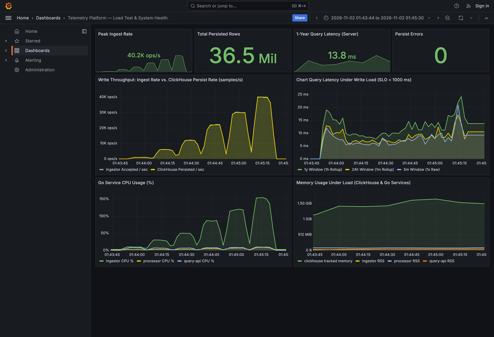

# Server Telemetry Platform

High-throughput Go telemetry backend built with **Hexagonal Architecture**, **Fiber**, **NATS JetStream**, **ClickHouse**, and **Prometheus + Grafana**. It ingests 7 percentage sensors (`0–100%`) emitted every second per server and serves `5m` to `1y` charts in **`~10–25 ms`** (`< 1s` target).

- **Architecture & Design Doc**: [`docs/ARCHITECTURE.md`](docs/ARCHITECTURE.md)
- **Detailed Load-Test Report**: [`docs/LOAD_TEST.md`](docs/LOAD_TEST.md)
- **Architecture Decision Records**: [`docs/adr/`](docs/adr/)

---

## 1. Quickstart (Single Command)

```bash
docker compose up -d --build
```

Once running:
- **Web Dashboard (`web/index.html`)**: http://localhost:8084
- **Grafana Load-Test & Ops Dashboard**: http://localhost:3002
- **ClickHouse Admin UI (`CH-UI`)**: http://localhost:3488 (`telemetry` / `telemetry`)
- **Ingestor HTTP Endpoint**: `http://localhost:8082/api/v1/telemetry`
- **Prometheus**: http://localhost:9092

On startup, the `simulator` container streams live `1s` metrics for `15` servers, backfills `3` days of history for all devices, and backfills **365 full days (`31,536,000` rows)** for `server-0001` in ~26 seconds.

### Useful Commands
```bash
make smoke                              # Run automated end-to-end smoke tests
make simulator DEVICES=50 DAYS=3        # Run standalone device traffic generator
make loadtest                           # Run step-ramp load test & update graphs
make test                               # Run Go unit tests with race detector
```

---

## 2. Code Walkthrough: End-to-End Message Flow

Here is what happens in the codebase from the moment a server sends a metric until it lands on disk and renders on a chart:

1. **HTTP Receive & Domain Validation (`ingestor`)**
   - [`httpingest/handler.go`](internal/adapter/inbound/httpingest/handler.go) reads the raw Fiber request body (decompressing pooled `gzip` if needed) and [`payload.go`](internal/adapter/inbound/httpingest/payload.go) decodes single or batched JSON samples.
   - [`domain.NewSample`](internal/domain/sample.go) enforces all invariants before anything enters the pipeline: non-empty `device_id`, valid UTC second timestamp, and all 7 sensor percentages strictly within `[0, 100]` (rejecting `NaN`/out-of-bounds with `400 Bad Request`).

2. **Micro-Batch Group Commit to Durable WAL (`natspub`)**
   - [`usecase.IngestService`](internal/usecase/ingest.go) hands validated samples to [`natspub.Publisher`](internal/adapter/outbound/natspub/publisher.go).
   - Instead of hitting disk per HTTP request, worker goroutines coalesce concurrent requests over an **`8 ms` / `4,000`-sample** window, pack them into a compact `TLMB` binary frame ([`codec/batch.go`](internal/adapter/codec/batch.go)), and wait for NATS JetStream's synchronous disk `PubAck` before returning `202 Accepted`. If the `2 GiB` WAL fills up, `DiscardNew` returns `503 Service Unavailable` so agents retry instead of losing data silently.

3. **Pull Consumption, Sorting & Columnar Write (`processor`)**
   - [`natssub.Consumer`](internal/adapter/inbound/natssub/consumer.go) pulls batches of binary frames from JetStream (`WorkQueuePolicy`).
   - [`usecase.ProcessBatchService`](internal/usecase/process.go) sorts the combined slice deterministically by `(DeviceID, Timestamp)`. Sorting matches ClickHouse's primary key (`ORDER BY (device_id, ts)`) and makes block-hash deduplication (`non_replicated_deduplication_window = 1000`) drop retried batches cleanly.
   - [`clickhouse/writer.go`](internal/adapter/outbound/clickhouse/writer.go) appends rows directly into native typed column slices (`PrepareBatch` + `Column.Append`). JetStream `msg.Ack()` is sent **only after** `batch.Send()` commits (`NakWithDelay` on failure).

4. **Write-Time Rollups & Sub-Second Query Routing (`query-api`)**
   - At `INSERT` time inside ClickHouse ([`clickhouse/schema.go`](internal/adapter/outbound/clickhouse/schema.go)), Incremental Materialized Views automatically update `telemetry_1m` (`1m` buckets), `telemetry_1h` (`1h` buckets storing `avgState`, `min`, `max`), and `devices_registry`.
   - When the browser requests `/api/v1/series`, [`domain.SelectResolution`](internal/domain/query.go) picks `1s` (`≤ 1h`), `1m` (`≤ 7d`), or `1h` (`> 7d` up to `1y`), and [`clickhouse/reader.go`](internal/adapter/outbound/clickhouse/reader.go) reads at most `8,760` pre-aggregated rows for a full year—returning to [`web/index.html`](web/index.html) in `~10–20 ms`.

---

## 3. Deployment & Load Testing

### Deployment Guide

The stack runs via [`docker-compose.yml`](docker-compose.yml) using a multi-stage static Go build ([`Dockerfile`](Dockerfile)):

| Service | Default Host Port | Port Override Env | Key Tuning Environment Variables | Healthcheck |
| :--- | :--- | :--- | :--- | :--- |
| **`ingestor`** | `8082` | `INGEST_PORT` | `INGEST_WORKERS=6`, `INGEST_BATCH_SIZE=4000`, `INGEST_FLUSH_MS=8` | `GET /healthz` |
| **`processor`** | `8083` | `PROCESSOR_PORT` | `PROCESSOR_WORKERS=3`, `PROCESSOR_FETCH_BATCH=32` | `GET /healthz` |
| **`query-api`** | `8084` | `QUERY_PORT` | `CLICKHOUSE_ADDR=clickhouse:9000` | `GET /healthz` |
| **`clickhouse`** | `8123` / `9000` | — | Capped at `2 GiB` (`deployments/clickhouse/config.d/memory.xml`) | `SELECT 1` |
| **`nats`** | `4222` / `8222` | — | JetStream `2 GiB` file store (`deployments/nats/nats-server.conf`) | `GET /healthz` |
| **`grafana`** | `3002` | `GRAFANA_PORT` | Auto-provisioned Prometheus datasource + Load Test dashboard | UI `:3002` |
| **`ch-ui`** | `3488` | `CH_UI_PORT` | ClickHouse table browser & data preview (`telemetry` / `telemetry`) | `GET /health` |

- **Start / Upgrade**: `docker compose up -d --build`
- **Graceful Shutdown**: All three Go services trap `SIGTERM`/`SIGINT`, drain active Fiber HTTP connections, flush in-flight micro-batches, finish active ClickHouse commits + NATS `ACK`s (`nc.Drain()`), and exit cleanly (`docker compose stop`).
- **Clean Reset**: `docker compose down -v` removes containers and persistent volumes (`nats_data`, `clickhouse_data`).

### Load Test Results (Grafana)

Tested on Apple M4 Max (Docker VM: `16` vCPUs, `7.65 GiB` RAM) with realistic **1 HTTP request/sec per simulated device** (`batch-per-req = 1`) while continuously querying `5m`, `24h`, and `1y` (`31.5M`-row `server-0001`) charts:

- **Sustained Load (Single Node)**: **`40,000` concurrent simulated servers** (`~40,000` req/s = `280,000` sensor readings/s) with **`0` HTTP errors** and **`0` persistence lag**.
- **1-Year Chart Latency Under Load**: **`~14 ms` server / `23–39.6 ms` `p95` HTTP RTT** (`<< 1,000 ms` requirement).
- **Bottleneck**: Beyond `~40k–45k` devices, edge HTTP concurrency on `ingestor` (`~160%` CPU, `8 ms` WAL durability wait) and ClickHouse's `2 GiB` configured memory cap reach their single-node limits first, while `processor` and `nats` stay around `10%` CPU. *(See [`docs/LOAD_TEST.md`](docs/LOAD_TEST.md) for the step table and 10k-device WAN plan.)*


