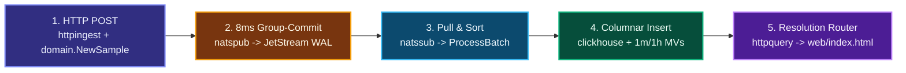

# Server Telemetry Platform


High-throughput Go telemetry platform built with **Hexagonal Architecture**, **Fiber**, **NATS JetStream**, **ClickHouse**, and **Prometheus + Grafana**. It ingests 7 percentage sensors (`0–100%`) emitted every second per server and serves `5m` to `1y` charts in **`21.3–32.7 ms` `p50` (`23.3–39.6 ms` `p95` under load; `< 1s` target)**.

- **Architecture & System Design**: [`docs/ARCHITECTURE.md`](docs/ARCHITECTURE.md)
- **Detailed Load-Test Report**: [`docs/LOAD_TEST.md`](docs/LOAD_TEST.md)
- **Architecture Decision Records**: [`docs/adr/`](docs/adr/)

---

## 1. Quickstart (Single Command)

```bash
make up
```

| Interface | Local URL | Notes |
| :--- | :--- | :--- |
| 🟣 **Web Dashboard (`web/index.html`)** | http://localhost:8084 | `5m`–`1y` interactive sensor charts (`0–100%` axis) |
| 🔴 **Grafana Dashboard** | http://localhost:3002 | Auto-provisioned load-test & service metrics (no login) |
| 🟢 **ClickHouse Admin (`CH-UI`)** | http://localhost:3488 | Visual table browser & SQL UI (`telemetry` / `telemetry`) |
| 🔵 **Ingestor HTTP API** | `http://localhost:8082/api/v1/telemetry` | Single & batch JSON + optional `gzip` |
| 🟠 **Prometheus** | http://localhost:9092 | Scrapes Go services & ClickHouse every `2s` |

On startup, `simulator` streams live `1s` metrics for `15` servers, backfills `3` days for all devices, and backfills **365 full days (`31,536,000` rows)** for `server-0001` in ~26 seconds.

```bash
make up                                 # Build and start the full stack
make smoke                              # Run automated end-to-end smoke tests
make simulator DEVICES=50 DAYS=3        # Run standalone device traffic generator
make loadtest                           # Run step-ramp load test & update graphs
make test                               # Run Go unit tests with race detector
make logs                               # Follow container logs
make stop                               # Gracefully stop containers (keeps data)
make down                               # Stop stack and remove volumes
```

---

## 2. Code Walkthrough: End-to-End Message Flow



1. **HTTP Receive & Domain Validation (`ingestor`)**
   - [`httpingest/handler.go`](internal/adapter/inbound/httpingest/handler.go) reads the Fiber request body (decompressing pooled `gzip` when set) and [`payload.go`](internal/adapter/inbound/httpingest/payload.go) decodes single or batched JSON samples.
   - [`domain.NewSample`](internal/domain/sample.go) checks `device_id`, UTC timestamp, and `[0, 100]` bounds on all 7 sensors—rejecting invalid values immediately with `400 Bad Request`.

2. **Micro-Batch Group Commit to Durable WAL (`natspub`)**
   - [`usecase.IngestService`](internal/usecase/ingest.go) passes samples to [`natspub.Publisher`](internal/adapter/outbound/natspub/publisher.go), where worker goroutines group concurrent requests over **`8 ms` / `4,000` samples**, encode a compact `TLMB` binary frame ([`codec/batch.go`](internal/adapter/codec/batch.go)), and wait for NATS JetStream's disk `PubAck` before returning `202 Accepted` (`503` backpressure if the `2 GiB` WAL fills up).

3. **Pull Consumption, Sorting & Columnar Write (`processor`)**
   - [`natssub.Consumer`](internal/adapter/inbound/natssub/consumer.go) pulls frame batches from JetStream (`WorkQueuePolicy`), and [`usecase.ProcessBatchService`](internal/usecase/process.go) sorts rows by `(DeviceID, Timestamp)` so ClickHouse writes sequentially (deduplicating in-place batch retries by block hash across raw and rollup tables, with at-least-once delivery if messages regroup after a crash or client HTTP retry; see [`ADR-004`](docs/adr/004-wide-schema-and-block-deduplication.md)).
   - [`clickhouse/writer.go`](internal/adapter/outbound/clickhouse/writer.go) appends native typed columns (`PrepareBatch` + `Column.Append`) and sends JetStream `msg.Ack()` **only after** commit (`NakWithDelay` on error).

4. **Write-Time Rollups & Sub-Second Query Routing (`query-api`)**
   - On insert ([`clickhouse/schema.go`](internal/adapter/outbound/clickhouse/schema.go)), ClickHouse Materialized Views update `telemetry_1m`, `telemetry_1h` (`avgState`, `min`, `max`), and `devices_registry`.
   - [`domain.SelectResolution`](internal/domain/query.go) routes `≤ 1h` to `1s` raw, `≤ 7d` to `1m`, and `> 7d–1y` to `1h` (`8,760` rows max), returning to [`web/index.html`](web/index.html) in `21.3–32.7 ms` `p50` (`23.3–39.6 ms` `p95` under load; `~13.8 ms` server-side).

---

## 3. Deployment & Load Testing

### Deployment Guide

| Service | Host Port | Override Env | Key Tuning Variables | Healthcheck |
| :--- | :--- | :--- | :--- | :--- |
| **`ingestor`** | `8082` | `INGEST_PORT` | `INGEST_WORKERS=6`, `INGEST_BATCH_SIZE=4000`, `INGEST_FLUSH_MS=8` | `GET /healthz` |
| **`processor`** | `8083` | `PROCESSOR_PORT` | `PROCESSOR_WORKERS=3`, `PROCESSOR_FETCH_BATCH=32` | `GET /healthz` |
| **`query-api`** | `8084` | `QUERY_PORT` | `CLICKHOUSE_ADDR=clickhouse:9000` | `GET /healthz` |
| **`clickhouse`** | `8123` / `9000` | — | `2 GiB` cap (`deployments/clickhouse/config.d/memory.xml`) | `SELECT 1` |
| **`nats`** | `4222` / `8222` | — | `2 GiB` JetStream file store (`deployments/nats/nats-server.conf`) | `GET /healthz` |
| **`grafana`** | `3002` | `GRAFANA_PORT` | Auto-provisioned Prometheus datasource + Load Test dashboard | UI `:3002` |
| **`ch-ui`** | `3488` | `CH_UI_PORT` | ClickHouse visual table explorer (`telemetry` / `telemetry`) | `GET /health` |

- **Start / Upgrade**: `make up`
- **Graceful Shutdown**: `make stop` — Go services trap `SIGTERM`/`SIGINT`, drain active Fiber HTTP requests, flush queued micro-batches, finish ClickHouse writes + NATS `ACK`s (`nc.Drain()`), and exit cleanly.
- **Clean Reset**: `make down` — stops containers and removes persistent volumes.

### Load Test Results (Grafana)

> [!TIP]
> **40,000 Concurrent Simulated Servers (`~40.2K` req/s = `280K` sensor readings/s)** sustained on a single node (Apple M4 Max Docker VM: `16` vCPUs, `7.65 GiB` RAM) with **`0` HTTP errors**, **`0` persistence lag**, and **`32.7 ms` `p50` / `39.6 ms` `p95` 1-year chart latency** (`~13.8 ms` server-side execution, `< 1,000 ms` SLO).

Beyond `~40k–45k` independent 1-req/sec devices, `ingestor` HTTP concurrency (`8 ms` WAL durability wait) and ClickHouse's `2 GiB` container memory cap reach their single-node limits first, while `processor` and `nats` stay near `10%` CPU. *(Full step table and 10k-device WAN plan in [`docs/LOAD_TEST.md`](docs/LOAD_TEST.md).)*


