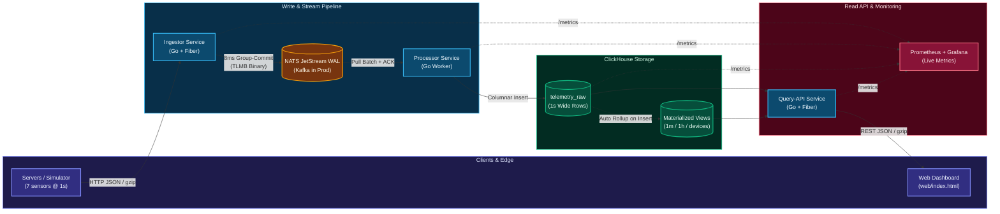
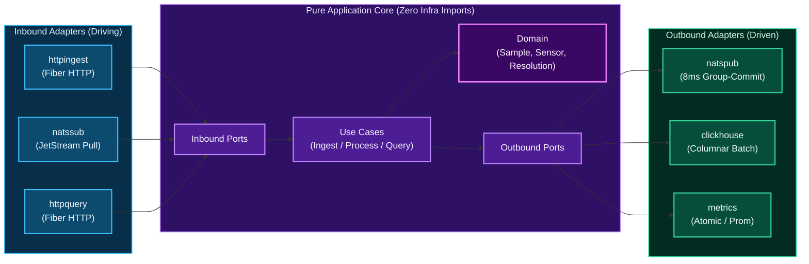

# System & Project Architecture


-7c3aed?style=flat-square)
-10b981?style=flat-square)

---

## Part 1: High-Level System Design

### System Diagram



### System Entities & Components

| Layer | Entity / Component | Role in the System | Why It Exists |
| :--- | :--- | :--- | :--- |
| 🟣 **Edge** | **Device / Simulator** | Sends 7 percentage metrics (`0–100%`: `cpu`, `memory`, `disk_space`, `disk_busy`, `net_rx`, `net_tx`, `fan`) every 1s over HTTP JSON/gzip. | Represents monitored Linux servers and generates 1-year historical + live traffic. |
| 🔵 **Service** | **Ingestor (`cmd/ingestor`)** | Lean Fiber HTTP service. Validates sensor bounds (`0–100%`) and pushes micro-batches into the broker. | Handles `40k+` concurrent requests/sec fast without waiting on database writes. |
| 🟠 **Queue** | **Broker (NATS / Kafka)** | Durable disk-backed queue (`WorkQueuePolicy` + `DiscardNew`) between Ingestor and Processor. | Absorbs spikes and protects data during DB restarts. Uses NATS locally (`~65 MiB` RAM); **Kafka** in production. |
| 🔵 **Service** | **Processor (`cmd/processor`)** | Pulls batches from the broker, sorts rows by `(device_id, ts)`, writes columnar blocks to ClickHouse, and ACKs after commit. | Turns thousands of tiny HTTP requests into sequential ClickHouse batch inserts with zero silent drops. |
| 🟢 **Storage** | **ClickHouse (`telemetry_raw`)** | Stores raw 1-second wide rows ordered by `(device_id, ts)` and partitioned monthly (`toYYYYMM(ts)`). | Compresses 7 sensors + timestamp to **`18.6 bytes/row`** (`~587 MB/device/year`) with S3 cold tiering support. |
| 🟢 **Rollup** | **Materialized Views (`1m`, `1h`)** | Pre-computes `avgState`, `min`, and `max` per minute and hour at insert time, plus a live device registry. | Lets a **1-year chart read `8,760` rows instead of `31.5M`**, loading in **`~10–20 ms`** (`< 1s` target). |
| 🔵 **Service** | **Query-API (`cmd/query-api`)** | Read-only Fiber API that routes queries (`1s` raw `≤ 1h`, `1m` `≤ 7d`, `1h` `≤ 1y`) and serves the UI. | Keeps heavy write traffic isolated from user dashboard reads. |
| 🟣 **Client** | **Web UI (`web/index.html`)** | Single-file HTML5 Canvas chart (`0–100%` shared Y-axis, device search, multi-sensor picker, `5m–1y` ranges). | Fast interactive chart exploration with zero frontend build step. |
| 🔴 **Ops** | **Prometheus & Grafana** | Scrapes `/metrics` across Go services and ClickHouse (plus **CH-UI** for table browsing). | Visualizes throughput, query latency, CPU, and memory live during load tests. |

---

### Why We Reached This Architecture

> [!TIP]
> **Core Idea**: Keep the HTTP entry point tiny and fast, buffer writes in a durable log, batch-insert into ClickHouse wide columns, and compute `1m` / `1h` rollups on write so 1-year charts never scan raw data.

1. **Decouple HTTP writes from the database**: Thousands of servers hit the entry point every second. Writing straight from HTTP handlers to ClickHouse causes `Too many parts` errors and drops metrics whenever the DB merges or restarts. Putting a durable broker between `ingestor` and `processor` turns `40,000` HTTP requests/sec into ~10 clean columnar inserts/sec.
2. **Sub-second (`< 1s`) 1-year charts via Materialized Views**: One server writes `31,536,000` rows/year (`315B` rows/year at `10,000` servers). ClickHouse Incremental Materialized Views update `telemetry_1m` and `telemetry_1h` (`avgState`, `min`, `max`) at insert time, so a 1-year query reads **`8,760` rows** in **`~10–20 ms`** while keeping peak spikes visible.
3. **NATS JetStream locally, Kafka in production**: JVM Kafka is heavy for a single-command `docker compose up` laptop test. NATS JetStream gives disk WAL durability and explicit ACKs in ~65 MB RAM locally, while our Hexagonal ports let us plug in **Apache Kafka** for multi-node partitioned production scale.
4. **1-year volume & cloud cost**: `18.62 B/row` raw + `~43 MB` rollups = **`~630 MB / server / year`**. For **10,000 servers**, 1 year is **`~5.73 TiB`** (`~11.5 TiB` replicated). With 30 days on hot NVMe and 11 months on S3 cold partitions, AWS runs around **`$1,700–$2,100/month`** total (or 70% less storage if `1s` raw data expires at 90 days while `1m`/`1h` rollups stay for years).
5. **10,000 real WAN servers — 3-month / 4-engineer plan**:
   - *What breaks first in production*: (1) TLS reconnect storms on `ingestor`, (2) single-node `2 GiB` broker disk cap if DB maintenance exceeds ~70 minutes, and (3) single-disk ClickHouse capacity.
   - *Team split*: **Eng 1** builds 2×2 replicated ClickHouse + S3 cold tiering + backups; **Eng 2** builds 3-node Kafka adapters + Envoy TLS/auth + `5–10s` agent batching; **Eng 3** adds `5s` query caching + rate limits + chaos tests; **Eng 4** builds the host agent disk ring-buffer + SLO alerts. *(Skipped on purpose: custom query DSL, Flink/Spark, or heavy custom dashboard builders.)*
6. **Zero-downtime DB migration**: Because core logic uses `SampleWriter` and `SampleReader` ports, we attach a second Kafka consumer group writing live data to the new DB from `T0`, backfill partitions `< T0`, run shadow reads to verify parity and `< 1s` latency, and flip a read flag (`1% → 100%`) while keeping ClickHouse live for 14 days for instant rollback.

> [!WARNING]
> **2 AM Paging vs. Daytime Tickets** (`99.95%` ingest SLO, `< 5s` freshness, `p99 < 800ms` chart reads):
> - **Wake on-call at 2 AM**: Ingest `5xx/503 > 1%` (5m), broker disk `> 75%` (< 2h to full), `persisted_samples` rate hits `0` while traffic arrives, or query `p99 > 1.5s` (10m).
> - **Daytime Slack/ticket only**: Single stateless pod restart, draining queue lag `< 20%`, disk `> 70%` with `> 7d` runway, or one monitored server going offline. *(Assumes NTP-synced `1s` UTC timestamps and fixed 7-sensor payload; full ADRs in [`docs/adr/`](adr/).)*

---

### How Much & How I Used AI

- **My Decisions (~60% — System Design, Structure & Review)**: I chose the 3-service architecture (lean ingestor → broker → processor → ClickHouse hot/cold partitions + query API), NATS locally vs. Kafka in production, strict Hexagonal Architecture with minimal comments, Fiber for HTTP, and the clean separation of `web/` and `scripts/` from `cmd/` and `internal/`.
- **AI Assistance (~40% — Coding Speed & Boilerplate)**: Used AI to speed up binary encoding (`internal/adapter/codec`), ClickHouse columnar `PrepareBatch` slices, the HTML5 Canvas chart (`web/index.html`), and load-test scripts.
- **Where I Overrode AI**: Enforced strict `domain`/`ports`/`usecase`/`adapter` boundaries over a flat package layout; moved `index.html` to `web/` and test runners to `scripts/`; switched `net/http` to Fiber v3; used deterministic sorting + `MergeTree` block-hash deduplication instead of `ReplacingMergeTree` alone (so Materialized Views never double-count retries); and switched JetStream to `WorkQueuePolicy` to prevent backfill OOMs.

---

## Part 2: Project Architecture (Hexagonal)



> [!IMPORTANT]
> **Strict Boundary Rule**: `internal/domain`, `internal/ports`, and `internal/usecase` import **zero** external packages (`go list` verified). Swapping `net/http` → `Fiber` or `NATS` → `Kafka` touches zero lines of core logic.

```text
├── cmd/                   # Production service binaries only (ingestor, processor, query-api)
├── internal/
│   ├── domain/            # Pure rules: 0–100% validation, sensor types, 1s/1m/1h resolution picker
│   ├── ports/             # Inbound & outbound interfaces decoupling core from infrastructure
│   ├── usecase/           # Application flows: Ingest, ProcessBatch (deterministic sort), QuerySeries
│   └── adapter/
│       ├── codec/         # Compact binary batch framing (TLMB) for broker messages
│       ├── inbound/       # Fiber HTTP handlers (httpingest, httpquery) & JetStream consumer (natssub)
│       └── outbound/      # JetStream micro-batch publisher (natspub), ClickHouse repo, Prometheus metrics
├── web/                   # Single-file HTML5 Canvas dashboard (index.html)
├── scripts/               # Standalone tools: simulator, smoketest, and loadtest runner
├── deployments/           # NATS, ClickHouse, Prometheus, and Grafana provisioning configs
└── docs/                  # Architecture doc, ADRs (001–005), and load-test charts
```
