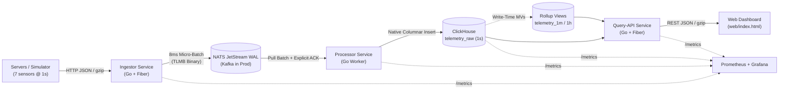
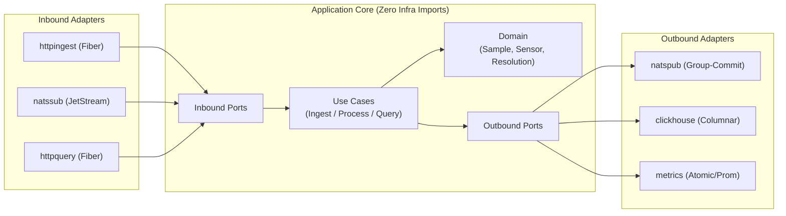

# System & Project Architecture

## Part 1: High-Level System Design

### System Diagram



### System Entities & Components

| Entity / Component | Role in the System | Why It Exists |
| :--- | :--- | :--- |
| **Device / Simulator** | Sends 7 percentage metrics (`0–100%`: `cpu`, `memory`, `disk_space`, `disk_busy`, `net_rx`, `net_tx`, `fan`) every 1 second over HTTP JSON (single or batch + gzip). | Represents monitored Linux servers and generates 1-year historical + live traffic. |
| **Ingestor (`cmd/ingestor`)** | Lean Fiber HTTP service. Validates sensor bounds (`0–100%`) and pushes micro-batches into the broker. | Handles thousands of concurrent device connections fast without waiting on database writes. |
| **Message Broker (NATS / Kafka)** | Durable disk-backed queue (`WorkQueuePolicy` + `DiscardNew`) between Ingestor and Processor. | Absorbs traffic spikes and protects data if ClickHouse restarts. Uses NATS JetStream locally for low RAM (`~65 MiB`); uses **Apache Kafka** in production. |
| **Processor (`cmd/processor`)** | Pulls message batches from the broker, sorts rows by `(device_id, ts)`, writes columnar blocks to ClickHouse, and ACKs only after commit. | Turns thousands of small HTTP requests into large sequential ClickHouse batch inserts with zero silent drops. |
| **ClickHouse (`telemetry_raw`)** | Stores raw 1-second wide rows ordered by `(device_id, ts)` and partitioned monthly (`toYYYYMM(ts)`). | Compresses 7 sensors + timestamp to **`18.6 bytes/row`** (`~587 MB/device/year`) and supports moving old partitions to S3 cold storage. |
| **Materialized Views (`1m`, `1h`, `devices`)** | Pre-computes `avg`, `min`, and `max` per minute and per hour at insert time, plus a live device list. | Lets a **1-year chart read `8,760` hourly rows instead of `31.5M` raw rows**, loading in **`~10–20 ms`** (`< 1s` requirement). |
| **Query-API (`cmd/query-api`)** | Read-only Fiber API that picks the right table (`1s` raw for `≤ 1h`, `1m` for `≤ 7d`, `1h` for `≤ 1y`) and serves the UI. | Keeps heavy write load completely isolated from user dashboard reads. |
| **Web UI (`web/index.html`)** | Single-file HTML5 Canvas chart (`0–100%` shared Y-axis, device search, multi-sensor picker, `5m–1y` ranges). | Gives users instant chart exploration with zero frontend build tooling. |
| **Prometheus & Grafana** | Scrapes `/metrics` across Go services and ClickHouse. | Visualizes throughput, query latency, CPU, and memory during load tests and operations. |

---

### Why We Reached This Architecture

1. **Keep ingestion lean and decoupled**: Thousands of servers hit the entry point every second. If the HTTP server wrote straight to the database, any slow disk merge or DB restart would block requests and drop metrics. Putting a lean `ingestor` in front of a durable log broker solves both problems—ClickHouse only receives clean, large columnar batches from `processor`.
2. **ClickHouse + Materialized Views for `< 1s` 1-year charts**: One server produces `31,536,000` rows per year (`315B` rows/year at `10,000` servers). Scanning 31.5M rows on every page view wastes disk I/O and cannot stay under 1 second on cold storage. ClickHouse Incremental Materialized Views compute `1m` and `1h` rollups (`avgState`, `min`, `max`) on the fly during insert, so `1y` queries finish in `~10–20 ms` while still keeping spike `min/max` bounds.
3. **NATS JetStream locally, Kafka in production**: For a single-command `docker compose up` exercise on one laptop, JVM Kafka eats unnecessary memory. NATS JetStream gives us disk durability and explicit ACKs in ~65 MB RAM locally, while our port interfaces let us swap in **Apache Kafka** for multi-node partitioned scale in production.
4. **Storage size & cost math**: At `18.62 bytes/row` raw + `~43 MB` rollups, 1 server takes **`~630 MB/year`**. For **10,000 servers**, 1 year is **`~5.73 TiB`** (`~11.5 TiB` replicated). Keeping 30 days on hot NVMe and moving older months to S3 cold storage costs roughly **`$1,700–$2,100/month`** total on AWS (compute + storage), or 70% less if raw `1s` data expires after 90 days while `1m`/`1h` rollups stay for years.
5. **Scaling to 10,000 real WAN devices (3-month, 4-engineer plan)**:
   - *What breaks first in production*: (1) TLS connection storms on `ingestor` after network blips, (2) single-node `2 GiB` broker disk cap if DB maintenance lasts > 1 hour, and (3) single-disk ClickHouse storage growth.
   - *3-month plan (4 engineers)*: **Eng 1** sets up 2×2 replicated ClickHouse + S3 cold tiering + backups; **Eng 2** adds 3-node Kafka adapter + Envoy TLS/auth + 5–10s agent batching; **Eng 3** adds 5s query cache + rate limits + chaos tests; **Eng 4** builds the host agent disk ring-buffer + SLO alerts. *(Intentionally skipped: custom query/alert DSL, Flink/Spark, or heavy custom frontend frameworks.)*
6. **Zero-downtime DB migration (if replacing ClickHouse in Year 1)**: Because services talk through `SampleWriter` and `SampleReader` ports, we attach a second Kafka consumer group writing live data to the new DB from `T0`, backfill partitions `< T0` in the background, run shadow reads to check parity and `< 1s` latency, then flip a read feature flag (`1% → 100%`) while keeping ClickHouse live for 14 days for instant rollback.
7. **Operations & 2 AM Paging**:
   - *SLOs*: `99.95%` ingest availability, `< 5s` freshness, `p99 < 800 ms` chart reads, `0` silent data loss.
   - *Wake on-call at 2 AM*: Ingest `5xx/503 > 1%` for 5m; broker disk `> 75%` (< 2h to full); `persisted_samples` rate drops to `0` while traffic arrives; query `p99 > 1.5s` for 10m.
   - *Daytime ticket only*: Single stateless pod restart, draining consumer lag `< 20%`, disk `> 70%` with `> 7d` runway, or an individual monitored server going offline.
   - *Assumptions & limits*: Assumes NTP-synced server clocks (`1s` UTC), fixed 7-sensor contract, block-hash deduplication (`non_replicated_deduplication_window = 1000`) for retries, and omits mTLS/RBAC in local Docker Compose. *(Full ADRs in [`docs/adr/`](adr/).)*

---

### How Much & How I Used AI

- **My Decisions (~60% — Architecture, Boundaries & Review)**: I defined the core 3-service pipeline (lean ingestor → message broker → batch processor → ClickHouse with hot/cold partitions + query API), chose NATS locally vs. Kafka in production, enforced strict Hexagonal Architecture with minimal comments, selected Fiber for the HTTP adapters, and restructured the repo so frontend (`web/`) and test tools (`scripts/`) stay cleanly separated from `cmd/` and `internal/`.
- **AI Assistance (~40% — Implementation Speed & Scaffolding)**: I used AI to speed up repetitive Go code: binary batch encoding (`internal/adapter/codec`), ClickHouse columnar `PrepareBatch` slices, the HTML5 Canvas UI (`web/index.html`), load-test runner scripts, and drafting initial ADR templates.
- **Where I Overrode AI**:
  1. Replaced AI's initial flat package suggestion with strict `domain` / `ports` / `usecase` / `adapter` isolation and `go list` boundary checks.
  2. Moved `index.html` out of `internal/` into top-level `web/` and separated `simulator`/`smoketest`/`loadtest` out of `cmd/` into `scripts/`.
  3. Switched HTTP adapters from `net/http` to `gofiber/fiber/v3`.
  4. Rejected `ReplacingMergeTree` alone for retry deduplication (since ClickHouse Materialized Views fire *before* background merges and would double-count rollups) in favor of deterministic batch sorting + `MergeTree` block-hash deduplication.
  5. Switched JetStream from `LimitsPolicy` to `WorkQueuePolicy` after catching an OOM during the `35M`-row backfill.

---

## Part 2: Project Architecture (Hexagonal)



### Project Structure Overview

All dependencies point strictly inward toward `internal/domain`: `domain`, `ports`, and `usecase` import zero third-party or infrastructure packages, so HTTP (`Fiber`), broker (`NATS`/`Kafka`), or storage (`ClickHouse`) adapters can be swapped without touching core logic.

```text
├── cmd/                   # Production service entrypoints only (ingestor, processor, query-api)
├── internal/
│   ├── domain/            # Pure business rules: 0–100% validation, sensor types, 1s/1m/1h resolution picker
│   ├── ports/             # Inbound & outbound interfaces decouple core logic from infra
│   ├── usecase/           # Application flows: Ingest, ProcessBatch (deterministic sort), QuerySeries
│   └── adapter/
│       ├── codec/         # Compact binary batch framing (TLMB) for broker messages
│       ├── inbound/       # Fiber HTTP handlers (httpingest, httpquery) & JetStream pull consumer (natssub)
│       └── outbound/      # JetStream micro-batch publisher (natspub), ClickHouse repo, Prometheus metrics
├── web/                   # Single-file HTML5 Canvas dashboard (index.html)
├── scripts/               # Standalone tools: simulator, smoketest, and loadtest runner
├── deployments/           # NATS, ClickHouse, Prometheus, and Grafana provisioning configs
└── docs/                  # Architecture doc, ADRs (001–005), and load-test artifacts
```
