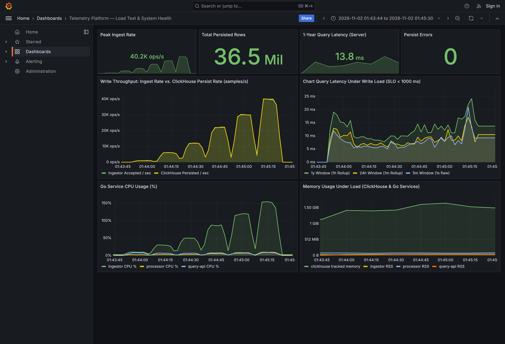
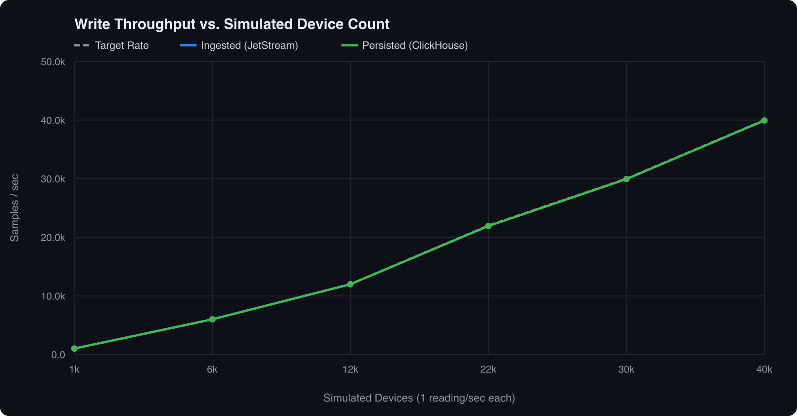
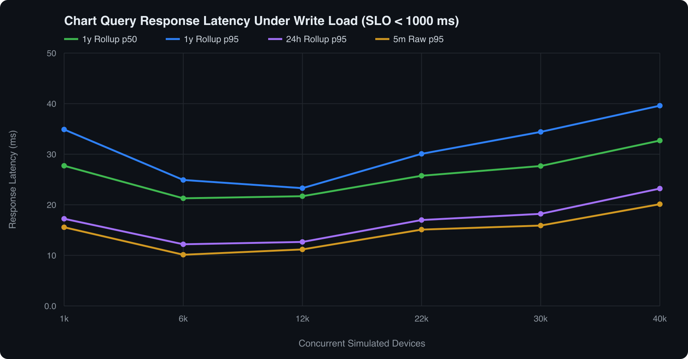
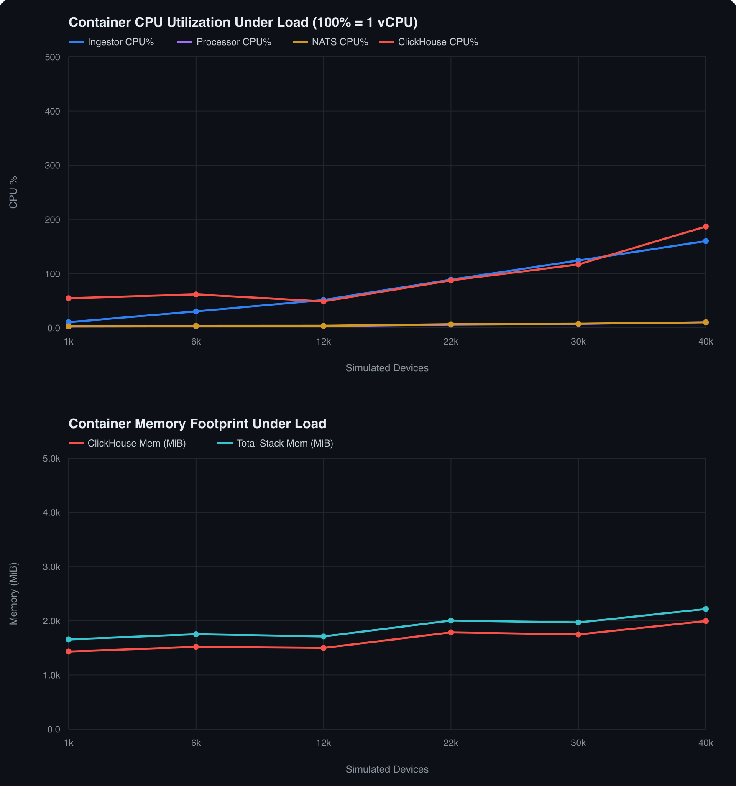

# Load Test & Bottleneck Report

## 1. Test Hardware & Setup

- **Machine**: Apple MacBook Pro (M4 Max, 16 cores, 48 GiB RAM, NVMe SSD)
- **Docker VM**: Docker Desktop `29.4.1` (`linux/aarch64`, **16 vCPUs, 7.65 GiB RAM** shared across containers)
- **Memory Caps**: ClickHouse `2 GiB`, Processor `512 MiB`, Ingestor `384 MiB`, NATS `320 MiB`, Query-API `256 MiB`
- **Workload (`make loadtest`)**:
  - Each simulated device sends **1 separate HTTP JSON POST every second** (`batch-per-req = 1`).
  - At the same time, read workers continuously query `5m` (`1s` raw), `24h` (`1m` rollup), and `1y` (`1h` rollup on `server-0001` with **31.5M raw rows**) charts.
  - A step passes only if HTTP errors stay `< 1%`, ClickHouse keeps up with ingestion, and `1y` chart `p95` stays `< 1,000 ms`.

---

## 2. Step-Ramp Results & Grafana Capture

| Simulated Devices | Ingest Rate | Persist Rate | HTTP Errors | `5m` `p95` | `24h` `p95` | `1y` `p50` | `1y` `p95` | Result |
| ---: | ---: | ---: | ---: | ---: | ---: | ---: | ---: | :--- |
| **1,000** | `1,011 /s` | `1,011 /s` | `0` | `15.6 ms` | `17.2 ms` | `27.7 ms` | `34.9 ms` | **PASS** |
| **6,000** | `6,011 /s` | `6,011 /s` | `0` | `10.1 ms` | `12.2 ms` | `21.3 ms` | `24.9 ms` | **PASS** |
| **12,000** | `11,989 /s` | `11,989 /s` | `0` | `11.2 ms` | `12.7 ms` | `21.7 ms` | `23.3 ms` | **PASS** |
| **22,000** | `21,935 /s` | `21,935 /s` | `0` | `15.1 ms` | `17.0 ms` | `25.7 ms` | `30.1 ms` | **PASS** |
| **30,000** | `29,944 /s` | `29,944 /s` | `0` | `15.9 ms` | `18.2 ms` | `27.7 ms` | `34.4 ms` | **PASS** |
| **40,000** | **`39,942 /s`** | **`39,943 /s`** | **`0`** | **`20.1 ms`** | **`23.2 ms`** | **`32.7 ms`** | **`39.6 ms`** | **PASS** |

*(With batched payloads during startup backfill, the same stack writes **`1.3M` samples/sec**—persisting `35.16M` rows in `~26s`.)*

### Grafana Live Dashboard Under Load

### Step-Ramp Charts (`scripts/loadtest`)

---

## 3. Bottleneck Analysis & What Breaks at 10,000 Production Devices

### Why Local Hardware Reaches Its Ceiling Above ~40k–45k RPS
Switching `ingestor` from `net/http` to **Fiber (`fasthttp`)** eliminated HTTP allocation errors up to `40,000` devices (`~40k` req/s, `0` errors). Beyond `~40k–45k` req/s, two limits meet: (1) HTTP edge concurrency on `ingestor` (`160%` CPU, where each request waits `~8.5 ms` for the group-commit flush + JetStream disk `PubAck`), and (2) ClickHouse's configured `2 GiB` container memory cap (`1,996 MiB` RSS at `40k` devices). Downstream, `natspub` packs `40k` HTTP requests/sec into ~10 binary frames/sec, so `processor` (`10.2%` CPU) and `nats` (`10.1%` CPU) stay idle and `1y` chart `p95` stays under `40 ms`.

### What Breaks First with 10,000 Real WAN Servers & How We Fix It
1. **TLS Reconnect & Flush Storms on `ingestor`**: After a network blip, 10,000 servers reconnect TLS at once and flush buffered metrics. *Fix*: Put Envoy/NGINX TLS termination + HTTP/2 in front of **3+ stateless `ingestor` pods**, and batch `5–10s` per agent POST with random jitter (`10k RPS → ~1–2k RPS`).
2. **Single-Node `2 GiB` Broker Disk Cap (`nats`)**: At `10k` samples/sec (`~1.7 GB/hr`), a `2 GiB` local queue fills up after ~70 minutes if ClickHouse is down for maintenance. *Fix*: Swap to a **3-node Apache Kafka (KRaft)** cluster (`RF=3`, 32 partitions by `device_id`, 48h disk retention) behind our existing `StreamPublisher` / `BatchProcessor` ports.
3. **Single-Disk ClickHouse Growth (`~5.73 TiB/year`)**: One node cannot hold multi-terabyte growth safely or survive hardware failure without downtime. *Fix*: Run a **2-shard × 2-replica `ReplicatedMergeTree` ClickHouse cluster** with `30d` hot NVMe + cold S3 `TTL` tiering while keeping `telemetry_1h` pinned on fast SSD.
